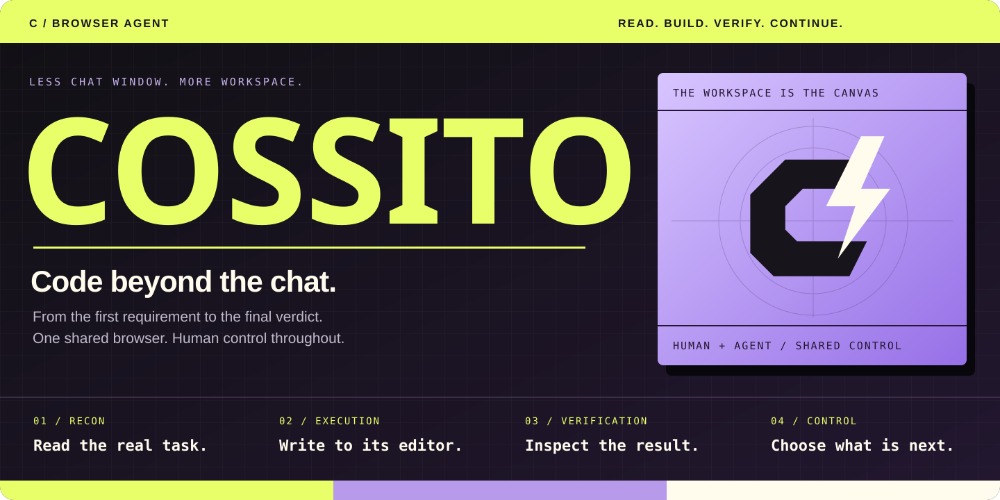
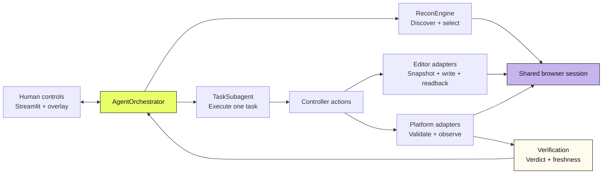

<div align="center">



### The task is on the page. So is the agent.

A browser agent that reads coding tasks, edits their workspaces, and checks the results.


[**Launch →**](#launch) · [**Explore →**](#the-workflow) · [**Take control →**](#your-controls) · [**Go deeper →**](#inside-cossito)

</div>

---

## Code with somewhere to go.

Cossito takes the coding workflow into a real browser: discover the lesson, read its requirements, inspect the existing code, write into the right editor, and look for a verified result. A persistent browser session connects the steps; a floating overlay keeps you close to the action.

Acid lime. Lavender. Oversized typography. Animated controls. The interface has a personality; the task lifecycle has explicit states and recorded evidence.

> **The code being written is progress. The platform confirming it works is completion.**

## The workflow

| `01` READ | `02` BUILD | `03` VERIFY | `04` CONTINUE |
| :--- | :--- | :--- | :--- |
| Discover tasks and their destinations. | Inspect each editor before writing. | Find the page's validation workflow. | Advance, repair, pause, or skip. |
| Distinguish lesson content from loading screens and navigation. | Preserve boilerplate and verify writes by reading them back. | Inspect test results and explicit completion evidence. | Keep unresolved work intact for review. |

### One workspace. Several moving parts.

- **Multiple editors, separate files.** Monaco, CodeMirror 5/6, Ace, and plain text surfaces. Use observed file or editor identifiers to route changes; ambiguous targets need clarification.
- **Task identity beyond a label.** Destination links and scoped navigation help distinguish repeated names such as “Part 001.” Nested controls sharing a destination are deduplicated.
- **References when they exist.** Images can inform frontend work. A task without a reference image can proceed from its written requirements.
- **Validation that follows the page.** Discover Submit, Check, Run Tests, or automatic validation instead of assuming one button exists everywhere.
- **Completion dialogs are part of the workflow.** Finalize an observed successful result before navigating through a modal-blocked workspace.
- **Connection recovery with continuity.** Bounded recovery reacquires the same open task tab. It does not intentionally reload the lesson or rewrite the solution.

<details>
<summary><strong>What Cossito will not assume</strong></summary>

A Next button does not establish success. A timeout does not establish failure. A model saying “done” does not replace platform evidence. A result on another task must not complete the current one.

Unfamiliar editors, missing results, model failures, and ambiguous page structures can still require human intervention. Support for an editor family is not a guarantee for every integration of that editor.

</details>

## Launch

### 01 / Get the workspace

```bash
git clone https://github.com/pujith-vijay-swamy/Cossito.git
cd Cossito
python -m venv .venv
```

<details open>
<summary><strong>Windows · PowerShell</strong></summary>

```powershell
.\.venv\Scripts\Activate.ps1
```

</details>

<details>
<summary><strong>macOS / Linux</strong></summary>

```bash
source .venv/bin/activate
```

</details>

### 02 / Install

```bash
python -m pip install -r requirements.txt
python -m playwright install chromium
```

Dependencies use minimum versions rather than a lockfile. Choose a Python version compatible with the browser-use version you install. Provider-specific dependencies may also be needed.

### 03 / Connect a model

Choose a provider, model, and API key in the sidebar. Integrations include OpenRouter, OpenAI, Anthropic, Google Gemini, Ollama, and local OpenAI-compatible endpoints. Availability and capabilities depend on your provider and installed packages.

For OpenRouter, copy [`.env.example`](.env.example) to `.env` and set:

```dotenv
OPENROUTER_API_KEY=your-key-here
```

Local models use the model name and base URL configured in the sidebar. Credentials, `.env`, and `browser_profile/` are ignored by Git.

### 04 / Start Cossito

```bash
python -m streamlit run app.py
```

Open the address printed by Streamlit. Enter the **target coding-page URL**, configure your model, and click **Start Agent**. Cossito's local interface and the target website are two separate addresses.

Complete login or human verification in the controlled browser when prompted. After backend changes, fully restart Streamlit to load the new code.

## Your controls

The main panel shows configuration, progress, code, and logs. The floating browser overlay keeps controls beside the task, and minimizes when you want the page space back.

| You want to… | Use… | What to expect |
| :--- | :--- | :--- |
| Take a look before continuing | **Pause** | Pause at the next supported control checkpoint. |
| Recheck an unresolved submission | **Resume** | Reinspect the existing result without automatically rewriting the code. |
| Leave this problem behind | A skip instruction | Preserve its code and result, record it as **skipped**, and continue the queue. |
| Guide the implementation | **Human Suggestion** | Supply instructions for the task. |
| End the run | **Stop** | Signal cancellation and stop further work. |

> [!IMPORTANT]
> Skip instructions currently use explicit phrase patterns, not unrestricted language understanding. Examples include **“skip,” “please skip this problem,” “skip the same problem,” “next task,”** and **“go to next lesson.”** Unusual wording may not match. Skipped tasks are not counted as passed.

### When a run needs attention

| What you see | What it means / next step |
| :--- | :--- |
| **No verified final verdict** | No fresh result was established. Run the page's tests and Resume, or skip the task. |
| **Different task displayed** | Restore the pending task to verify it, or skip it. Results are not transferred between lessons. |
| **Client is stopping** | The browser connection is being replaced or closed. Recovery is bounded and requires the original tab to remain available. |
| **Loading or unavailable content** | The lesson is not yet readable. Successful completion dialogs are handled separately; unrelated dialogs need your attention. |
| **Ambiguous editor destination** | Reinspect the editor list and use the observed identifier for each file. |

## Inside Cossito



<details>
<summary><strong>Open the source map</strong></summary>

| Module | Responsibility |
| :--- | :--- |
| [`app.py`](app.py) | Streamlit UI and run controls |
| [`agent_core.py`](agent_core.py) | Task orchestration and workspace safeguards |
| [`recon_engine.py`](recon_engine.py) | Discovery, identity, and task selection |
| [`task_subagent.py`](task_subagent.py) | Per-task execution and pending-result checks |
| [`controller_actions.py`](controller_actions.py) | Writing, validation, result reporting, and human actions |
| [`browser_manager.py`](browser_manager.py) | Shared browser lifecycle and connection recovery |
| [`dom_extraction.py`](dom_extraction.py) | Readiness, requirements, and reference extraction |
| [`editor_adapters.py`](editor_adapters.py) | Editor targeting and verified writes |
| [`platform_adapters.py`](platform_adapters.py) | Validation controls and visible result extraction |
| [`verification.py`](verification.py) | Verdict parsing and stale-evidence checks |
| [`models.py`](models.py) · [`state_machine.py`](state_machine.py) | Data, evidence, budgets, and task transitions |
| [`human_loop.py`](human_loop.py) · [`overlay_manager.py`](overlay_manager.py) | Human commands, pause coordination, and browser overlay |
| [`llm_provider.py`](llm_provider.py) · [`prompts.py`](prompts.py) | Providers and agent instructions |
| [`runtime_evolution.py`](runtime_evolution.py) | Bounded recovery and skill-learning support |

</details>

## Build. Break. Verify.

Focused Python checks:

```bash
python -m unittest discover -s tests -p "test_execution_progress.py" -v
python -m unittest discover -s tests -p "test_skip_controls.py" -v
python -m unittest discover -s tests -p "test_browser_recovery.py" -v
python -m unittest discover -s tests -p "test_page_readiness.py" -v
```

The full Python suite:

```bash
python -m unittest discover -s tests -p "test_*.py" -v
```

<details>
<summary><strong>Browser fixtures · Python + Node.js</strong></summary>

The Python multi-editor browser tests use installed Google Chrome by default. Set `PLAYWRIGHT_CHROMIUM_EXECUTABLE` to use another compatible browser binary.

```bash
python -m unittest discover -s tests -p "test_multi_editor_browser.py" -v
```

Node fixtures require the **Node Playwright package**, separately from Python Playwright:

```bash
npm install --no-save --package-lock=false playwright
npx playwright install chromium
node --test tests/test_page_readiness.cjs tests/test_completion_workflows.cjs
```

These fixtures also accept `PLAYWRIGHT_CHROMIUM_EXECUTABLE`. Local `node_modules/` stays out of commits.

</details>

Focused checks validate specific behaviors, not every website/provider combination or full live execution. For a useful bug report, include the task stage, visible result, and relevant logs with credentials and private website details removed.

---

<div align="center">


### READ THE PAGE. WRITE THE CODE. CHECK THE PROOF.

**COSSITO** / The browser is where it happens.

[Back to the top ↑](#)

</div>
