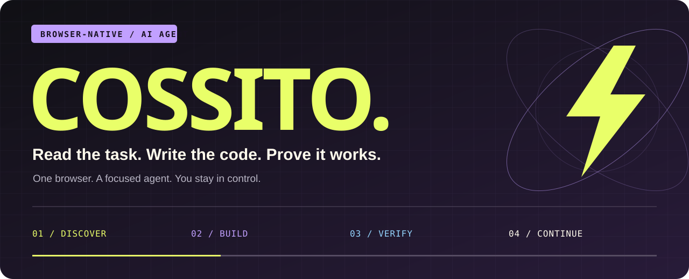
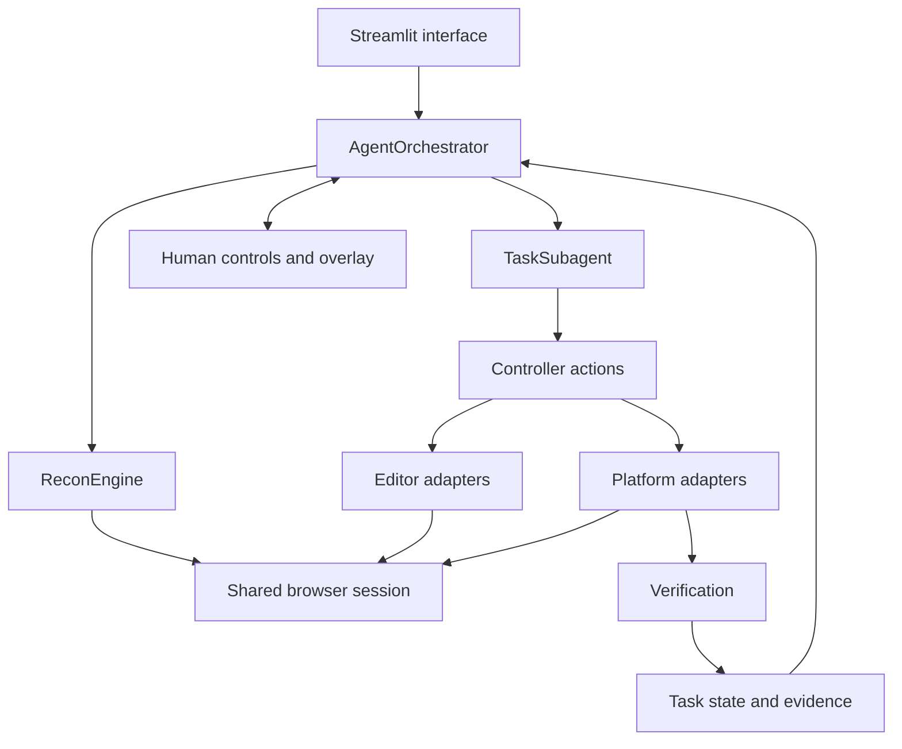

<div align="center">



**A browser agent for coding tasks. Built to act. Designed to stay accountable.**


[Start here](#launch-cossito) · [What it does](#from-page-to-proof) · [Architecture](#under-the-hood) · [Development](#build-on-it)

</div>

---

## Your browser. With follow-through.

Cossito opens a coding workspace, reads its requirements, builds a task queue, writes solutions into the editor, and checks the platform's results. A floating control panel keeps progress, logs, and pause/resume controls close to the work.

The interface brings acid lime, lavender, cinematic typography, and animated controls. Underneath, a shared browser session and explicit task states keep reconnaissance, execution, and verification connected.

> **Writing code is a step. Verified completion is the finish line.**

## From page to proof

| Phase | What happens |
| :--- | :--- |
| **01 — Discover** | Read the loaded task, distinguish requirements from page navigation, and build the queue. |
| **02 — Build** | Inspect the existing code, preserve the required structure, and write through editor adapters. |
| **03 — Verify** | Discover Submit, Run Tests, Check, or automatic completion; inspect the actual result. |
| **04 — Continue** | Complete verified work, repair confirmed failures, or pause when evidence is inconclusive. |

### The details that make a difference

- **One persistent browser.** Reuse the workspace and login session across tasks.
- **Multiple editor families.** Adapters for Monaco, CodeMirror 5/6, Ace, textareas, and contenteditable surfaces.
- **Optional visual references.** Extract reference images when available; continue from written requirements when none exist.
- **Adaptive validation.** Inspect available controls instead of assuming every page has a Submit button.
- **Evidence before success.** Read test counts, explicit completion messages, and scoped completed-state controls. Failure evidence takes precedence.
- **Preserve working state.** Avoid rewriting matching editor content; inspect an unresolved submission before generating another solution.
- **Redirect-aware navigation.** Keep the validated startup destination so canonical host and HTTPS redirects do not trigger restoration loops.
- **Human control.** Pause, resume, stop, skip, or provide suggestions through the UI and browser overlay.

These are supported behaviors, not a promise that every website or model will work without adjustment. Unusual editors, inaccessible results, and ambiguous completion flows may still need human input.

## Launch Cossito

### 1. Clone and create an environment

```bash
git clone https://github.com/pujith-vijay-swamy/Cossito.git
cd Cossito
python -m venv .venv
```

Activate it on **Windows PowerShell**:

```powershell
.\.venv\Scripts\Activate.ps1
```

Or on **macOS / Linux**:

```bash
source .venv/bin/activate
```

### 2. Install the dependencies

```bash
python -m pip install -r requirements.txt
python -m playwright install chromium
```

Dependency versions are lower bounds, not a locked environment. Use a Python version compatible with the installed browser-use release.

### 3. Configure a provider

Select a provider, model, and API key in the sidebar. The UI offers OpenRouter, OpenAI, Anthropic, Google Gemini, Ollama, and local OpenAI-compatible endpoints. Provider-specific dependencies and model capabilities vary.

For OpenRouter, you can also copy `.env.example` to `.env` and set:

```dotenv
OPENROUTER_API_KEY=your-key-here
```

For local providers, configure the model name and base URL in the sidebar. Keep `.env`, credentials, and the persistent `browser_profile/` directory out of commits; they are already ignored.

### 4. Start the interface

```bash
python -m streamlit run app.py
```

Open the local address printed by Streamlit, enter the **target coding-page URL**, choose your model, and select **Start Agent**. The target URL is the workspace Cossito should operate on; it is separate from Cossito's own UI address.

Complete login or other human prompts in the controlled browser when requested, then resume. After changing backend Python modules, fully restart Streamlit so the next run loads the updated implementation.

## A cockpit, not a black box

**The main panel** configures the run and shows task progress, generated code, and logs. **The floating overlay** brings the same working context into the target browser, with a minimized view when you need the page space back.

If verification remains unknown, preserve the page and inspect its result. A timeout is not proof of failure, a Next button is not proof of success, and model confidence is not a substitute for platform evidence.

## Under the hood



| File | Responsibility |
| :--- | :--- |
| [`app.py`](app.py) | Streamlit interface and background-run controls |
| [`agent_core.py`](agent_core.py) | Orchestration, task lifecycle, workspace recovery |
| [`recon_engine.py`](recon_engine.py) | Task discovery and selection |
| [`task_subagent.py`](task_subagent.py) | Per-task execution and result handling |
| [`controller_actions.py`](controller_actions.py) | Code-writing, validation, verification, and human actions |
| [`browser_manager.py`](browser_manager.py) | Persistent browser startup and page acquisition |
| [`dom_extraction.py`](dom_extraction.py) | Page readiness, task text, and reference extraction |
| [`editor_adapters.py`](editor_adapters.py) | Editor detection, snapshots, writes, and readback |
| [`platform_adapters.py`](platform_adapters.py) | Validation controls and visible result extraction |
| [`verification.py`](verification.py) | Verdict parsing and stale-evidence checks |
| [`models.py`](models.py) / [`state_machine.py`](state_machine.py) | Typed data and task transitions |
| [`llm_provider.py`](llm_provider.py) / [`prompts.py`](prompts.py) | Model integrations and instructions |
| [`human_loop.py`](human_loop.py) / [`overlay_manager.py`](overlay_manager.py) | Pause/resume coordination and browser controls |
| [`runtime_evolution.py`](runtime_evolution.py) | Bounded recovery and skill-learning support |

## Build on it

Run the Python suite:

```bash
python -m unittest discover -s tests -p "test_*.py" -v
```

Or focus on a behavior:

```bash
python -m unittest discover -s tests -p "test_workspace_navigation.py" -v
python -m unittest discover -s tests -p "test_submission_actions.py" -v
python -m unittest discover -s tests -p "test_verification.py" -v
```

Browser fixtures use Node.js and the **Node Playwright package**, separately from the Python dependency:

```bash
npm install --no-save --package-lock=false playwright
npx playwright install chromium
node --test tests/test_submission_dom.cjs tests/test_completion_workflows.cjs
```

You can point `PLAYWRIGHT_CHROMIUM_EXECUTABLE` at an existing Chrome/Chromium binary for those fixtures. Keep local `node_modules/` out of commits.

Tests cover specific behavior; focused passing tests do not imply every provider, website, or full-suite configuration has been validated. When reporting a bug, include the task stage, visible result, and relevant logs with secrets removed.

---

<div align="center">


**READ → BUILD → VERIFY → CONTINUE**

*Made for the moment when the code has to leave the chat and work in the browser.*

</div>
